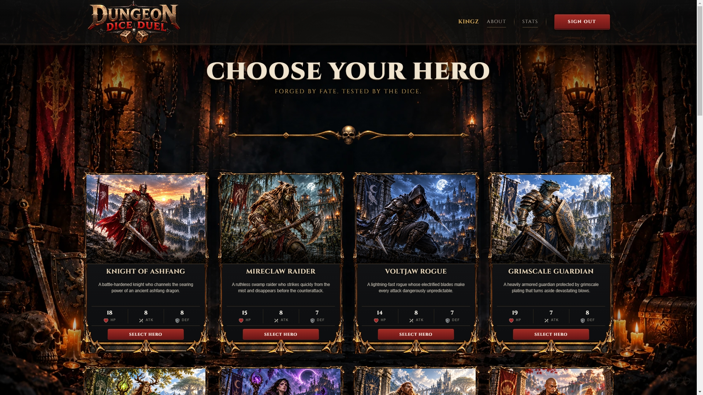
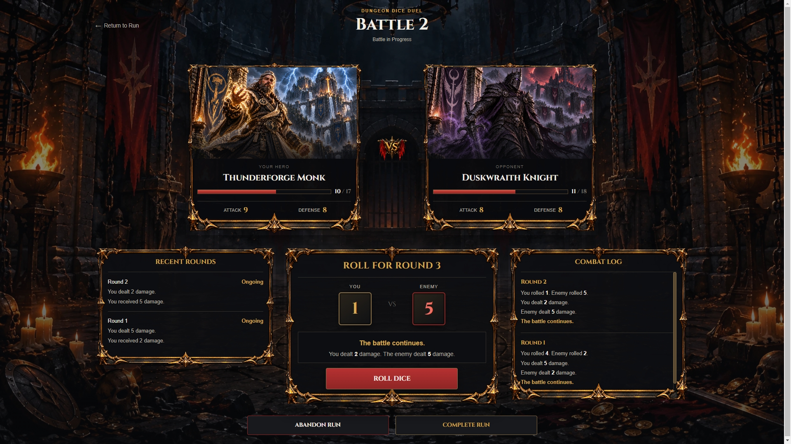
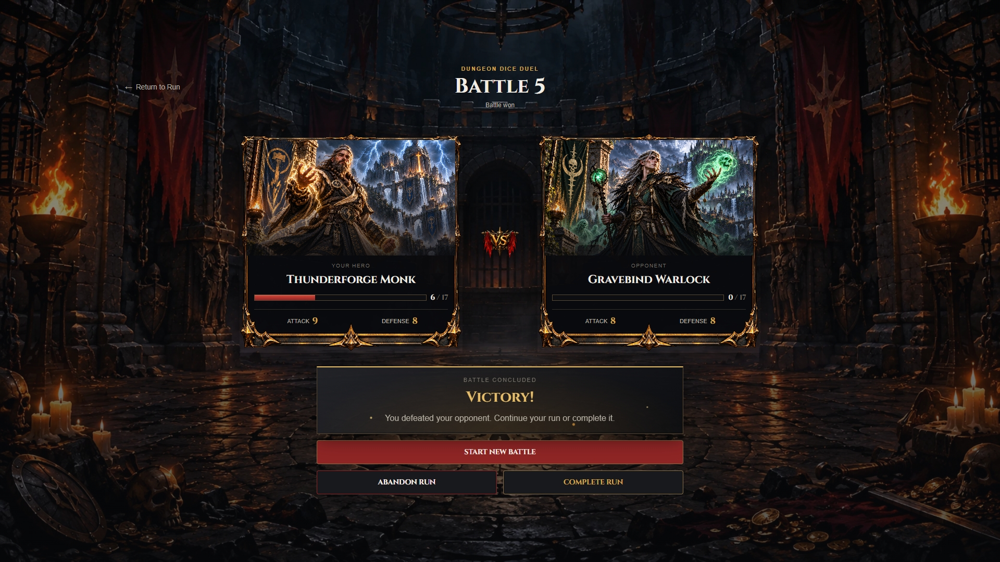
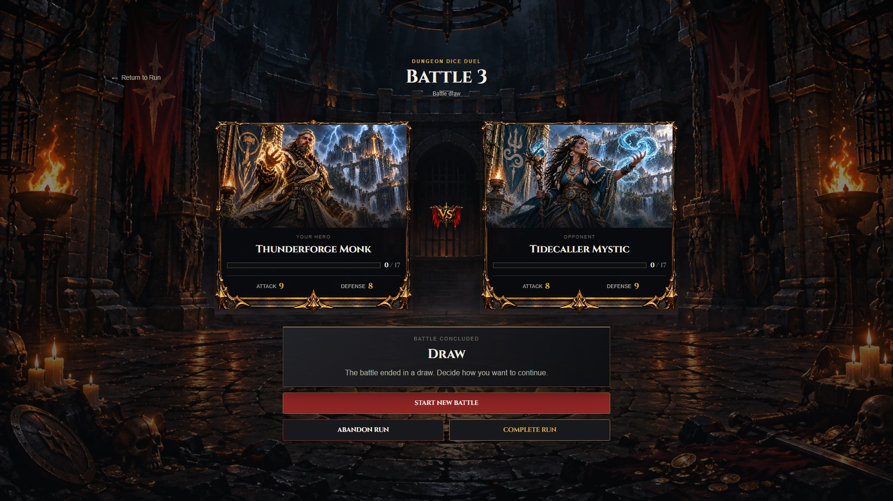
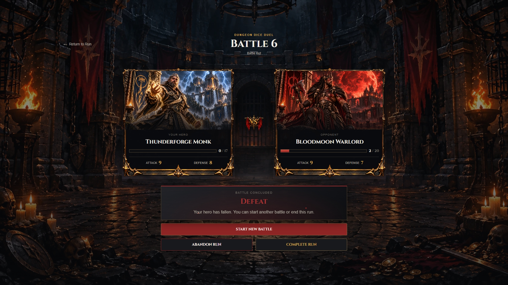
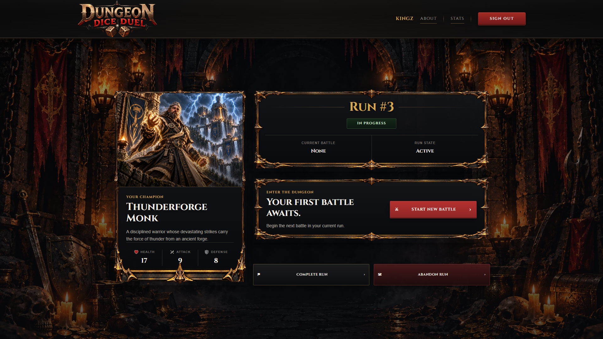
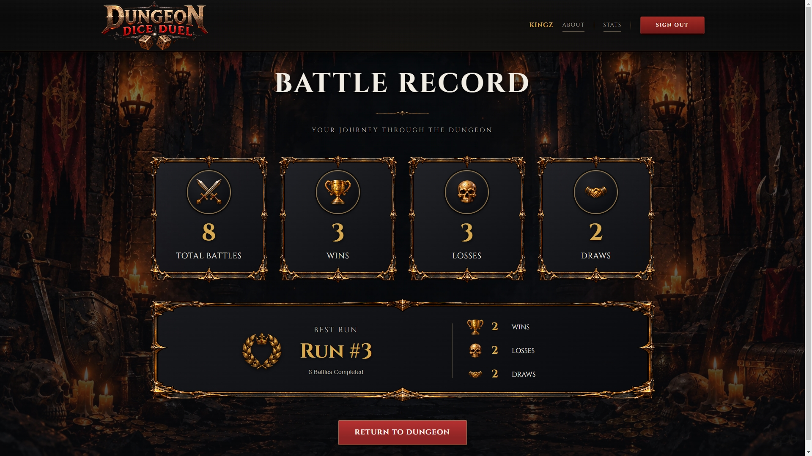
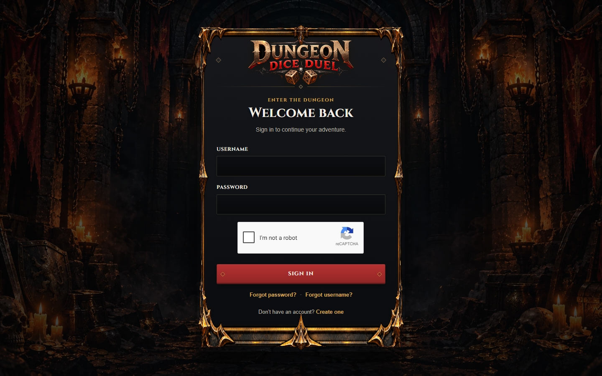
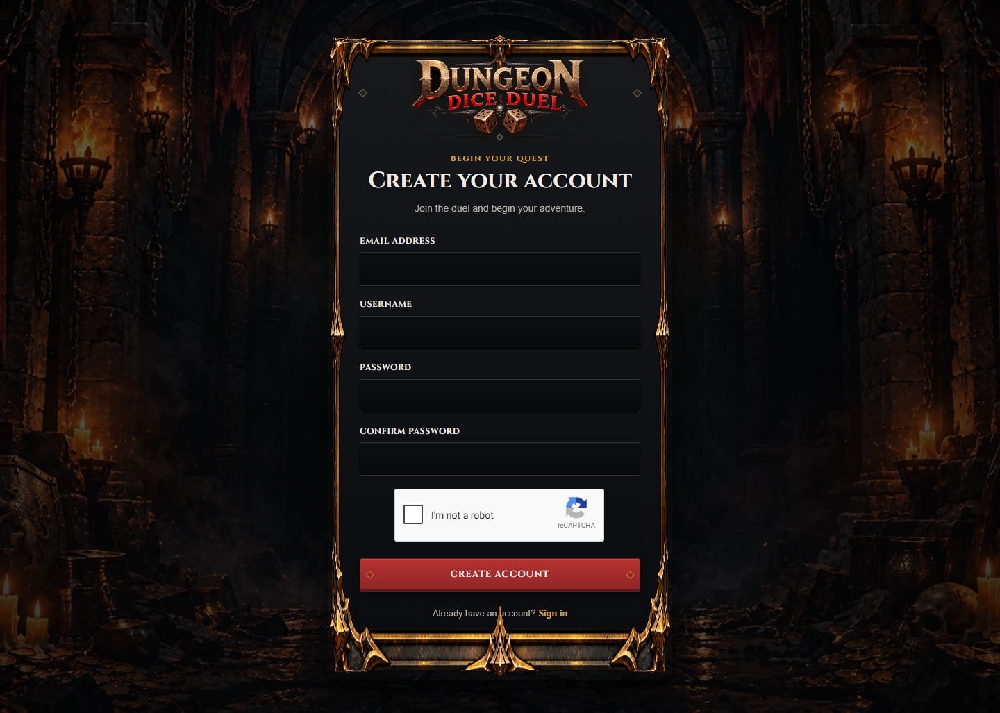
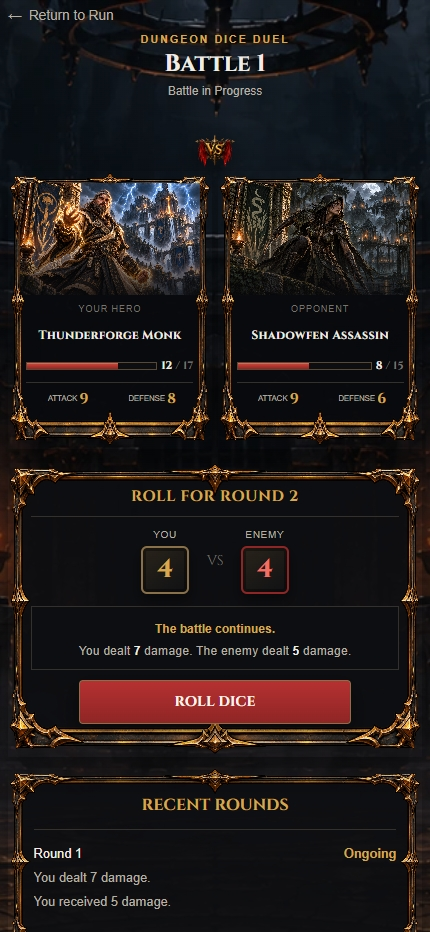

# Dungeon Dice Duel

**A full-stack, turn-based fantasy RPG built with React, TypeScript, Express, and SQLite.**

Dungeon Dice Duel began as a backend-focused game-development project and grew into a complete, deployed web application. Players choose heroes, enter the dungeon, battle enemies through dice-driven combat, manage game runs, and review their performance. Behind the game is a persistent backend with authentication, session management, battle and run lifecycle rules, player statistics, email verification, and account recovery.

This project represents roughly two months of iterative development—from interpreting the original specification and building the game engine to redesigning the frontend, testing complex game states, and deploying the application to production.

**Play the game:** [dungeon-dice.kingsleyonwupeluonye.dev](https://dungeon-dice.kingsleyonwupeluonye.dev)

**Production API:** [api.dungeon-dice.kingsleyonwupeluonye.dev](https://api.dungeon-dice.kingsleyonwupeluonye.dev/api)

---

## Contents

- [The original brief](#the-original-brief)
- [How the project evolved](#how-the-project-evolved)
- [Features](#features)
- [Technology stack](#technology-stack)
- [Architecture](#architecture)
- [Engineering challenges and solutions](#engineering-challenges-and-solutions)
- [What I learned](#what-i-learned)
- [Development milestones](#development-milestones)
- [Project structure](#project-structure)
- [Local development setup](#local-development-setup)
- [Environment variables](#environment-variables)
- [API overview](#api-overview)
- [Database and persistence](#database-and-persistence)
- [Testing and verification](#testing-and-verification)
- [Production deployment](#production-deployment)
- [Future possibilities](#future-possibilities)
- [Acknowledgements](#acknowledgements)

---

## The original brief

The project originated from the *Dungeon Dice Game* solo-project guide documented in Notion. The guide organized the work into three main epics.

**Epic 1 — Game dynamics**

The original assignment called for an Express API that powered an existing frontend. Players needed to select heroes, start battles, roll dice, calculate damage, defeat opponents, and reset the dungeon. The backend had to satisfy a documented API contract so the supplied interface could play the game.

**Epic 2 — Database and game progress**

The next objective was to move hero data into SQLite and persist battle results against game runs. This introduced database tables, data access, seeding, and the distinction between an ongoing session and a completed battle.

**Epic 3 — Authentication and player progress**

The final core epic introduced registration, login, logout, authenticated sessions, and per-user progress. Viewing player statistics was identified as a stretch goal.

The accompanying frontend was a small HTML, CSS, and JavaScript application. The original brief explicitly assumed that the frontend was already provided and that the main task was to implement its API.

That was the starting point—not the final scope of Dungeon Dice Duel.

## How the project evolved

Rather than stopping when the original API contract was satisfied, I expanded the project into a more complete full-stack application.

The backend grew into a TypeScript application with domain logic, repositories, services, controllers, migrations, session persistence, lifecycle validation, and comprehensive automated tests. The original interface was replaced by a React frontend with its own routing, feature organization, authentication flows, game screens, statistics page, and custom visual identity.

The result is a project that demonstrates more than implementing endpoints. It brings together game logic, relational data modeling, authentication, frontend architecture, state synchronization, interface design, automated verification, and production deployment.

The guiding principle throughout development was to **preserve clear responsibilities, solve actual problems, and verify each stage before moving forward**.

---

## Features

### Gameplay and progression

- **Hero selection:** Browse a roster of 24 seeded heroes, each with individual health, attack, defense, descriptive text, and artwork.
- **Dice-driven combat:** Play turn-based battles in which the backend determines dice rolls, damage, health changes, and combat outcomes.
- **Battle history:** Persist battle rounds and their outcomes so that the game can reconstruct the state of a battle.
- **Game runs:** Start a run with a selected hero, continue through multiple battles, and complete or abandon the run.
- **Resume support:** Retrieve the active run and battle from the backend rather than relying exclusively on temporary browser state.
- **Lifecycle protection:** Prevent invalid transitions, including starting a second active run or starting another battle while the current battle remains active.
- **Run and battle numbering:** Present stable, human-friendly numbers without exposing internal database IDs as the main player-facing identifiers.
- **Player statistics:** View performance derived from persisted game history, including battles, wins, losses, draws, and best-run information.

### Accounts and security

- Account registration and login using username and password.
- Password hashing with `bcrypt`.
- Server-managed authentication sessions.
- Persistent SQLite session storage.
- Google reCAPTCHA v2 checkbox verification for registration and login.
- Email verification using Brevo transactional email.
- Password reset through time-limited, single-use recovery tokens.
- Username recovery through email.
- Authentication and ownership checks on protected game resources.
- Input validation and consistent API error handling.

### User experience

- A custom dark-fantasy visual identity.
- Dedicated hero-selection, game-run, battle, statistics, authentication, and About pages.
- Custom hero artwork, backgrounds, frames, icons, and typography.
- Battle panels, dice presentation, round results, and combat history.
- Loading, error, and confirmation states.
- Responsive layouts for desktop and smaller screens.
- Direct navigation and refresh support for application routes.

---

## Screenshots and Gameplay

Dungeon Dice Duel combines turn-based, dice-driven combat with persistent game progression, player statistics, and account management.

### Hero Selection

Browse the available heroes, compare their attributes, and choose a hero for your dungeon run.



### Battle Screen

Engage enemies in turn-based combat, resolve dice rolls, and track health and battle progress.



### Battle Outcome

View the outcome of a battle and continue your game run.

#### Victory



#### Draw



#### Defeat



### Game Run

Manage an active run and continue progressing through battles.



### Player Statistics

Review your gameplay performance using statistics derived from persisted game history.



### Authentication

Create an account or sign in to access player-specific game progress.

#### Login



#### Register



### Responsive Interface

The interface adapts to smaller screens so players can access the game on mobile devices.



---

## Technology stack

| Area | Technologies |
|---|---|
| Frontend | React 19, TypeScript, Vite |
| Routing | React Router 7 |
| Styling | CSS, shared theme variables, responsive layouts |
| CAPTCHA | `react-google-recaptcha`, Google reCAPTCHA v2 |
| Backend | Node.js, TypeScript, Express 5 |
| Database | SQLite, `better-sqlite3` |
| Authentication | `bcrypt`, `express-session` |
| Session persistence | Custom SQLite session store |
| Email | Brevo transactional email integration |
| Backend testing | Vitest, Supertest |
| Frontend quality checks | TypeScript build, Vite build, ESLint |
| Frontend hosting | Netlify |
| Backend hosting | Google Cloud VM |
| Reverse proxy and DNS | Nginx, Cloudflare |
| Production transport | HTTPS, credentialed CORS, secure session cookies |

The frontend and backend have separate package manifests and dependency trees. The frontend makes feature-local `fetch()` requests rather than relying on a centralized API client.

---

## Architecture

The application separates the user interface from the authoritative game and persistence logic.

```text
                       Player's browser
                              |
                              v
                    React + TypeScript
                    React Router 7
                              |
                         HTTPS / API
                              |
                              v
                     Express 5 REST API
                              |
            +-----------------+------------------+
            |                 |                  |
            v                 v                  v
      Authentication     Game runs and        Player
      and sessions          battles          statistics
            |                 |                  |
            +-----------------+------------------+
                              |
                              v
                        SQLite database
                              |
              +---------------+----------------+
              |               |                |
              v               v                v
            Users          Game data       Sessions and
                                          recovery tokens
```

### Frontend responsibilities

The React application owns:

- Page rendering and navigation.
- Forms and user interactions.
- Loading, error, and confirmation presentation.
- Displaying game state returned by the API.
- Updating the interface after actions such as starting a run or playing a battle round.

React Router loaders and actions handle route-related data retrieval and form submissions where appropriate. Feature-specific components and actions perform the fetch requests they need.

### Backend responsibilities

The Express application owns:

- Authentication and session lifecycle.
- Request validation and authorization.
- Hero retrieval and seeding.
- Game-run and battle state transitions.
- Dice rolls, damage calculations, and combat outcomes.
- Battle-round and player-statistics persistence.
- Database migrations and transactional updates.
- Email verification, recovery tokens, and email delivery integration.

The backend remains authoritative for gameplay. The frontend does not invent dice results, calculate authoritative damage, or decide whether a run or battle has completed.

### Backend structure

The backend follows a straightforward separation of concerns:

- **Routes** define HTTP endpoints and authentication requirements.
- **Controllers** handle request and response behavior.
- **Services** implement application and gameplay rules.
- **Repositories** handle database access.
- **Domain modules** define game entities, types, and combat logic.
- **Database modules** initialize SQLite, apply migrations, and seed heroes.
- **Middleware** handles authentication checks and centralized errors.

This structure makes it possible to test individual rules and repositories as well as complete HTTP workflows without introducing unnecessary abstraction layers.

---

## Engineering challenges and solutions

The most valuable parts of the project were not simply adding features. They were making those features work together without corrupting game state, weakening authentication, or creating deployment-specific failures.

### 1. Evolving the original frontend into a React application

**The challenge:** The original project assumed a prebuilt vanilla JavaScript frontend. Its API contract was useful, but the interface and architecture were not sufficient for the larger application I wanted to build.

**The solution:** I created a React and TypeScript client using Vite and React Router. I organized the interface around features such as authentication, heroes, runs, battles, statistics, and About. I introduced route loaders, actions, shared components, environment-based API configuration, and consistent error handling while keeping data fetching close to the feature that uses it.

**What this demonstrates:** The ability to translate an existing specification into a larger application while establishing a new frontend architecture without unnecessarily changing the backend's responsibilities.

### 2. Making game-run and battle lifecycles consistent

**The challenge:** A game is not a collection of independent API calls. Starting a run, beginning a battle, playing rounds, resetting, completing a run, and logging out all affect related records.

An incorrect transition could leave a run active after it should have ended, allow multiple active battles in the same run, or record an outcome for a battle that was abandoned.

**The solution:** I implemented explicit run and battle states, server-side validation, ownership checks, and transactional updates where related records must change together. The backend prevents multiple active runs for a user and multiple active battles within a run. Resetting or completing a run abandons any active battle associated with it, and completed or abandoned battles cannot accept additional rounds.

**What this demonstrates:** Thinking about the full lifecycle of persistent entities, not just the happy path through an endpoint.

### 3. Supporting refresh-safe run and battle resumption

**The challenge:** A browser refresh or navigation event can discard transient frontend state. A game that depends on a hero ID or battle object existing only in navigation state cannot reliably resume.

**The solution:** I added backend endpoints to retrieve the current run, retrieve the active battle, and retrieve an individual battle. The frontend uses those endpoints to reconstruct the appropriate screen from persisted state. Enemy details and combat attributes are stored with the battle so its presentation and behavior do not depend on a later random enemy selection.

**What this demonstrates:** Understanding the difference between transient UI state and durable application state, and designing API contracts around that distinction.

### 4. Maintaining a secure authentication and session boundary

**The challenge:** Authentication had to work across a separately hosted frontend and backend. It also had to preserve session isolation, reject unauthorized access to another player's records, and remain functional after server restarts.

**The solution:** I used password hashing, `express-session`, a persistent SQLite session store, session regeneration during authentication, and server-side authorization checks. Production configuration accounts for the reverse proxy, credentialed CORS, HTTPS, and secure HTTP-only cookies.

Logging out also participates in the game lifecycle: an active run is completed according to the application's rules before the session is destroyed.

**What this demonstrates:** Treating authentication as an application boundary rather than a simple login form.

### 5. Implementing account recovery and email verification

**The challenge:** Email verification and account recovery introduce security requirements that ordinary registration does not. Recovery links must expire, be single-use, and not expose credentials or reveal unnecessary account information.

**The solution:** I added database migrations and services for email verification and password recovery, integrated Brevo for transactional email, and used time-limited tokens whose hashes are stored in the database rather than the raw tokens. Recovery endpoints use generic responses where account enumeration would otherwise be possible. reCAPTCHA verification is performed by the backend before the relevant operation proceeds.

**What this demonstrates:** Applying security considerations to the entire account lifecycle, including cases that occur after registration and login.

### 6. Testing the interaction between multiple layers

**The challenge:** A unit test for a service cannot by itself prove that an HTTP endpoint, session, database transaction, and frontend-facing response contract work together.

**The solution:** I built a backend test suite using Vitest and Supertest. It includes unit tests, repository tests, integration tests, session tests, migration and seeding tests, and API contract tests. The suite exercises invalid transitions, cross-user access attempts, authentication failures, battle completion, run resets, and recovery flows.

**What this demonstrates:** Using tests to verify application invariants and regressions, not merely to increase a test count.

### 7. Deploying a stateful application to production

**The challenge:** Deploying a frontend is relatively straightforward. A backend that stores user accounts, sessions, game runs, and battles must preserve its database and session behavior while operating behind HTTPS and a reverse proxy.

**The solution:** I deployed the React frontend to Netlify and the Express backend to a Google Cloud VM. Nginx proxies requests to the Node.js process, Cloudflare handles DNS and HTTPS proxying, and SQLite resides on persistent storage outside the application source directory. The production environment explicitly configures the database path, frontend origin, session secret, and external service credentials.

I verified the production health endpoint, database connectivity, deployment builds, automated tests, and application flows.

**What this demonstrates:** Considering networking, persistence, configuration, security, and operational verification as part of full-stack development.

---

## What I learned

Dungeon Dice Duel strengthened several areas of my development practice.

### Backend engineering

I learned to reason more carefully about domain rules and state transitions. A run and a battle each have their own lifecycle, but their states also constrain one another. Express endpoints must enforce those rules consistently, and related database updates must remain coherent.

I also developed a clearer understanding of how repositories, services, controllers, domain types, and migrations can work together without adding abstraction solely for its own sake.

### TypeScript and maintainability

Working with a strict TypeScript backend required attention to request and session types, explicit return types, module configuration, and the boundary between runtime behavior and type declarations.

The project reinforced the value of using types to make contracts and state transitions easier to understand, while still testing runtime behavior rather than assuming type correctness proves an implementation works.

### Authentication and persistence

I gained practical experience with session regeneration, persistent session storage, password hashing, credentialed cross-origin requests, secure cookies, token-based recovery, and database migrations.

An important lesson was that a successful login is only one part of authentication. Session persistence, logout behavior, ownership enforcement, and recovery flows must also be correct.

### Frontend architecture and API integration

Rebuilding the client helped me practice structuring a React application around features and routes, using loaders and actions, and keeping API requests near the UI behavior that needs them.

I also learned to treat backend responses as the source of truth. Resuming a battle, updating health, or displaying statistics should reflect persisted server data rather than assumptions held by the browser.

### Testing and debugging

The project reinforced a disciplined development workflow: finish the implementation for a stage, run the relevant checks, investigate failures, and confirm that existing behavior still works before moving forward.

The comprehensive backend suite was particularly useful for testing lifecycle edge cases that are easy to miss during manual gameplay.

### UI design and product thinking

The visual work went beyond applying styles to a working interface. I iterated on hero artwork, background assets, typography, theme variables, framed panels, battle presentation, statistics, responsive layouts, and error states.

That process taught me to separate presentation changes from gameplay changes, reuse existing assets and components where appropriate, and prioritize consistency and usability over unnecessary rewrites.

### Deployment and operations

Deploying the application made the relationship between frontend configuration, backend configuration, DNS, HTTPS, CORS, cookies, process management, and persistent storage concrete.

It also reinforced an important principle: a successful build is not the same as a verified production deployment. The application must be exercised through its actual deployed frontend and API.

---

## Development milestones

The project progressed through a series of backend stages, frontend stages, and deployment milestones. The following timeline groups related work to show the progression from the original specification to the production application.

### Phase 1 — Core game and database foundation

I started with the original requirements for hero selection and dice-driven combat, then built the backend foundations needed to support a persistent game.

- Implemented the combat engine and battle outcomes.
- Introduced typed domain models and database repositories.
- Added SQLite migrations and hero seeding.
- Persisted users, game runs, battles, and battle rounds.
- Established the first API and integration tests.

### Phase 2 — Authentication and player-specific data

I extended the application from a game API into a system that supports individual players.

- Implemented registration, login, logout, and current-user retrieval.
- Added password hashing and session management.
- Introduced authenticated access to game resources.
- Implemented game-run persistence and player statistics.
- Added session and ownership tests.

### Phase 3 — Lifecycle integrity and resumable gameplay

I addressed the more subtle problems that emerge when a game spans multiple requests and browser visits.

- Defined explicit run and battle states.
- Added run completion and abandonment behavior.
- Prevented conflicting active runs and battles.
- Made resets and related state changes consistent.
- Added endpoints for resuming runs and retrieving battles.
- Stored enemy combat data with the battle.
- Refined run and battle numbering for the player-facing interface.

### Phase 4 — Account security and recovery

I expanded the account system beyond basic credentials.

- Added Google reCAPTCHA verification.
- Introduced email addresses and email-verification support.
- Integrated Brevo transactional email.
- Implemented password reset and username recovery.
- Added time-limited, single-use recovery tokens and associated persistence.
- Tested authentication and recovery failure cases.

### Phase 5 — React frontend architecture and gameplay

I replaced the original small JavaScript interface with a React application designed around the expanded backend.

- Established the Vite and React application structure.
- Introduced routing, feature-local data fetching, and environment configuration.
- Built authentication and entry flows.
- Implemented hero selection, run entry, run resumption, and battle resumption.
- Connected battle-round actions to the backend.
- Built a player statistics page.

### Phase 6 — Visual design and responsive refinement

I iterated on the presentation after the core application flows were working.

- Created a consistent dark-fantasy visual identity.
- Refined hero images, backgrounds, frames, typography, and icons.
- Redesigned the run, battle, statistics, and error interfaces.
- Improved battle result presentation and user feedback.
- Refined run numbering and confirmation flows.
- Completed a responsive UI pass and checked navigation and application behavior.

### Phase 7 — Production deployment and verification

The final phase moved the application from local development to separate production services.

- Deployed the frontend to Netlify.
- Deployed the backend to a Google Cloud VM.
- Configured Nginx, Cloudflare, DNS, and HTTPS.
- Preserved SQLite data on persistent storage.
- Configured production session handling and credentialed CORS.
- Ran the backend build and full automated test suite.
- Verified the deployed health endpoint and production game flows.

The completed application is available at the live URL above.

---

## Project structure

The project lives inside the `Dungeon Dice game/` directory of the larger repository.

```text
Dungeon Dice game/
├── client/
│   ├── public/
│   ├── src/
│   │   ├── assets/
│   │   ├── components/
│   │   ├── features/
│   │   │   ├── about/
│   │   │   ├── auth/
│   │   │   ├── battles/
│   │   │   ├── heroes/
│   │   │   ├── runs/
│   │   │   └── statistics/
│   │   ├── styles/
│   │   ├── main.tsx
│   │   ├── router.tsx
│   │   └── App.tsx
│   ├── .env.example
│   └── package.json
│
├── server/
│   ├── scripts/
│   ├── src/
│   │   ├── config/
│   │   ├── controllers/
│   │   ├── db/
│   │   │   └── migrations/
│   │   ├── domain/
│   │   ├── errors/
│   │   ├── middleware/
│   │   ├── repositories/
│   │   ├── routes/
│   │   ├── services/
│   │   ├── types/
│   │   ├── app.ts
│   │   └── server.ts
│   ├── .env.example
│   └── package.json
│
└── README.md
```

The client and server have independent build and configuration processes. The database migrations live with the backend, and the backend build copies them into the compiled output.

---

## Local development setup

### Prerequisites

- Node.js and npm.
- Git.
- A supported environment for `better-sqlite3` if a compatible prebuilt native binary is unavailable.

### 1. Clone the repository

```bash
git clone https://github.com/Kingz00/Full-Stack-Developer-Projects.git
cd "Full-Stack-Developer-Projects/Dungeon Dice game"
```

If you already have the repository locally, navigate to the `Dungeon Dice game` directory.

### 2. Install and configure the backend

```bash
cd server
npm ci
```

Copy `.env.example` to `.env`.

PowerShell:

```powershell
Copy-Item .env.example .env
```

macOS or Linux:

```bash
cp .env.example .env
```

Configure the backend environment variables as described below. In particular, set a secure session secret and a database path appropriate for your local environment.

Start the development server:

```bash
npm run dev
```

The API listens on port `3000` by default.

### 3. Install and configure the frontend

Open a second terminal:

```bash
cd "Dungeon Dice game/client"
npm ci
```

Copy `.env.example` to `.env.local`.

PowerShell:

```powershell
Copy-Item .env.example .env.local
```

macOS or Linux:

```bash
cp .env.example .env.local
```

Configure the API URL and reCAPTCHA site key.

Start Vite:

```bash
npm run dev
```

Open the local URL shown by Vite, normally `http://localhost:5173`.

Make sure the backend's `FRONTEND_ORIGIN` matches the frontend origin being used. Restart the backend after changing its environment configuration.

### 4. Check backend health

Open:

```text
http://localhost:3000/api/health
```

A healthy response includes:

```json
{
  "status": "ok",
  "database": "ok"
}
```

The health endpoint checks whether the database can be queried. The backend also applies migrations and seeds hero data during startup.

---

## Environment variables

### Backend — `server/.env`

| Variable | Purpose |
|---|---|
| `NODE_ENV` | Runtime environment. Use `production` in production. |
| `PORT` | Port on which Express listens. Defaults to `3000`. |
| `DATABASE_PATH` | Path to the SQLite database. |
| `FRONTEND_ORIGIN` | Exact frontend origin allowed by CORS. |
| `SESSION_SECRET` | Secret used to sign session identifiers. Must contain at least 32 bytes. |
| `RECAPTCHA_SECRET_KEY` | Private key used for server-side reCAPTCHA verification. |
| `BREVO_API_KEY` | API key for the Brevo email integration. |
| `EMAIL_FROM_ADDRESS` | Sender address for transactional email. |
| `EMAIL_FROM_NAME` | Display name for outgoing email. |

Example local configuration:

```dotenv
NODE_ENV=development
PORT=3000
DATABASE_PATH=data/dungeon-dice.db
FRONTEND_ORIGIN=http://localhost:5173
SESSION_SECRET=replace-with-a-random-secret-of-at-least-32-bytes
RECAPTCHA_SECRET_KEY=

BREVO_API_KEY=
EMAIL_FROM_ADDRESS=
EMAIL_FROM_NAME=Dungeon Dice Duel
```

Generate a random local session secret with Node.js:

```bash
node -e "console.log(require('node:crypto').randomBytes(32).toString('hex'))"
```

### Frontend — `client/.env.local`

| Variable | Purpose |
|---|---|
| `VITE_API_BASE_URL` | Base URL used for API requests. |
| `VITE_RECAPTCHA_SITE_KEY` | Public reCAPTCHA site key used in the browser. |

Example local configuration:

```dotenv
VITE_API_BASE_URL=http://localhost:3000/api
VITE_RECAPTCHA_SITE_KEY=
```

The production frontend uses:

```dotenv
VITE_API_BASE_URL=https://api.dungeon-dice.kingsleyonwupeluonye.dev/api
VITE_RECAPTCHA_SITE_KEY=<production-reCAPTCHA-site-key>
```

**Security:** Never commit `.env` files, session secrets, Brevo credentials, or the reCAPTCHA secret key. Variables prefixed with `VITE_` are exposed to client-side code; they must not contain private credentials.

---

## API overview

The production API base URL is:

```text
https://api.dungeon-dice.kingsleyonwupeluonye.dev/api
```

The following table summarizes the main endpoints. Request validation and authentication requirements are enforced by the backend.

| Method | Endpoint | Purpose |
|---|---|---|
| `GET` | `/health` | Check API and database health. |
| `GET` | `/heroes` | Retrieve the available hero roster. |
| `POST` | `/auth/register` | Register an account. |
| `POST` | `/auth/login` | Authenticate a user. |
| `POST` | `/auth/logout` | End the session and apply logout lifecycle behavior. |
| `GET` | `/auth/me` | Retrieve the authenticated user. |
| `POST` | `/auth/email-verification/request` | Request an email-verification message. |
| `POST` | `/auth/email-verification/verify` | Verify an email address using a token. |
| `POST` | `/auth/forgot-password` | Initiate password recovery. |
| `POST` | `/auth/reset-password` | Reset a password using a recovery token. |
| `POST` | `/auth/forgot-username` | Initiate username recovery. |
| `GET` | `/runs/current` | Retrieve the current active run. |
| `POST` | `/runs` | Create a game run with a selected hero. |
| `POST` | `/runs/:runId/reset` | Reset an active run according to lifecycle rules. |
| `POST` | `/runs/:runId/abandon` | Abandon an active run. |
| `POST` | `/runs/:runId/complete` | Complete an active run. |
| `GET` | `/runs/:runId/battles/active` | Retrieve the active battle for a run. |
| `POST` | `/runs/:runId/battles` | Start a battle in a run. |
| `GET` | `/battles/:battleId` | Retrieve a battle and its persisted state. |
| `POST` | `/battles/:battleId/rounds` | Play a battle round. |
| `GET` | `/stats` | Retrieve the authenticated player's statistics. |

Endpoints that operate on user-specific runs, battles, or statistics require an authenticated session. The backend checks resource ownership rather than trusting IDs supplied by the browser.

For session-authenticated requests, the browser must include credentials. The production API uses credentialed CORS restricted to the configured frontend origin.

---

## Database and persistence

Dungeon Dice Duel uses SQLite through `better-sqlite3`. Database initialization enables foreign-key enforcement and write-ahead logging.

The database schema is managed through versioned SQL migrations. The current migration sequence establishes:

1. User accounts.
2. Hero data.
3. Game runs.
4. Battles.
5. Battle rounds.
6. User email addresses.
7. Email verification and password-reset token storage.

The application seeds **24 heroes** during startup. The seed process is designed to update existing hero data without creating duplicates when it is run repeatedly.

### Data integrity

The database uses constraints, foreign keys, indexes, and unique identifiers to protect relationships between users, runs, battles, and rounds. A partial unique index also enforces the one-active-battle-per-run rule at the database level.

Game services enforce additional lifecycle and ownership rules. Related run and battle status changes are performed transactionally when they must succeed or fail together.

### Production database

The production database is stored at:

```text
/var/lib/dungeon-dice-duel/dungeon-dice.db
```

It resides outside the application source directory on persistent VM storage. Deploying new application code should not replace this database.

The application applies migrations during startup. Avoid running manual migrations independently against production or copying a development database over the production database.

---

## Testing and verification

Testing was a major part of the backend development process. The suite covers individual components as well as the interactions between HTTP requests, authentication sessions, game rules, and database persistence.

### Backend commands

Run these commands from `server/`:

| Command | Purpose |
|---|---|
| `npm run dev` | Start the development server with `tsx watch`. |
| `npm run build` | Compile TypeScript and copy migrations into the build output. |
| `npm start` | Start the compiled server. |
| `npm test` | Run the full Vitest suite. |
| `npm run test:watch` | Run Vitest in watch mode. |
| `npm run db:migrate` | Run the migration script explicitly. |
| `npm run db:seed` | Run the hero seeding script explicitly. |

### What the backend tests cover

- Authentication, validation, password hashing, and session isolation.
- Session regeneration and persistent SQLite session storage.
- Authorization and cross-user resource access.
- Game-run creation, reset, completion, abandonment, and ownership.
- Battle creation, round execution, outcomes, and lifecycle restrictions.
- Repository and service behavior.
- API response contracts.
- Database initialization, migrations, and repeatable hero seeding.
- Player statistics.
- reCAPTCHA verification.
- Email verification and password recovery.
- Server startup and health-check behavior.

**Verified deployment test result:** 34 test files passed and 373 tests passed during the production backend deployment.

### Frontend commands

Run these commands from `client/`:

| Command | Purpose |
|---|---|
| `npm run dev` | Start the Vite development server. |
| `npm run build` | Run TypeScript project builds and create the production bundle. |
| `npm run preview` | Preview the production build locally. |
| `npm run lint` | Run ESLint. |

The frontend build, lint checks, navigation, and relevant user flows were verified during development. Frontend verification also included manual checks of the deployed application.

---

## Production deployment

The frontend and backend are deployed separately, allowing each application to have its own build, runtime configuration, and operational responsibilities.

### Frontend — Netlify

**Live URL:** [https://dungeon-dice.kingsleyonwupeluonye.dev](https://dungeon-dice.kingsleyonwupeluonye.dev)

The Netlify build configuration uses:

- **Base directory:** `Dungeon Dice game/client`
- **Build command:** `npm run build`
- **Publish directory:** `dist`, relative to the client base directory

The production environment configures `VITE_API_BASE_URL` and `VITE_RECAPTCHA_SITE_KEY`. Because these variables are included in the frontend build, changes require a new deployment.

React Router routes are served through the deployed single-page application configuration. Direct navigation to application routes was verified after deployment.

### Backend — Google Cloud VM

**API URL:** [https://api.dungeon-dice.kingsleyonwupeluonye.dev/api](https://api.dungeon-dice.kingsleyonwupeluonye.dev/api)

The backend runs on a Google Cloud VM. Nginx reverse-proxies traffic to the Node.js process, which is managed by systemd.

The service is named:

```text
dungeon-dice-duel.service
```

It runs the compiled application entry point:

```text
/usr/bin/node dist/server.js
```

The production database path is configured explicitly and points to persistent storage outside the source tree.

### Cloudflare, HTTPS, and sessions

Cloudflare manages DNS and HTTPS proxying for the production API hostname. Nginx forwards requests to Express, and the production application is configured to trust the reverse-proxy hop.

Because the frontend and API use different origins, the backend explicitly allows the production frontend origin and credentials. Session cookies are HTTP-only and secure in production, and the session data is persisted in SQLite.

This setup keeps the frontend and API independently deployable while supporting browser-based session authentication over HTTPS.

### Production health check

The deployed health endpoint is:

[https://api.dungeon-dice.kingsleyonwupeluonye.dev/api/health](https://api.dungeon-dice.kingsleyonwupeluonye.dev/api/health)

It checks database connectivity and returns HTTP `200` when the API and database are healthy.

### Final production verification

After deployment, I verified:

- Successful frontend and backend deployments.
- API health and database connectivity.
- Direct navigation and application routes.
- Registration, login, session persistence, and logout.
- Game-run creation and resumption.
- Battle creation, combat rounds, and battle resumption.
- Statistics retrieval and updates.
- Protected-page behavior after logout.
- Email verification and recovery flows where configured.
- Backend build and automated tests.

These checks confirmed that the deployed application worked across the frontend, API, sessions, database, and external integrations.

---

## Future possibilities

The deployed application delivers the planned core gameplay and account flows. Further development could explore:

- More heroes, enemies, and combat encounters.
- Additional progression and gameplay balancing.
- More detailed statistics and long-term player achievements.
- Expanded battle presentation and optional gameplay effects.
- Further observability and operational monitoring.

These are possible future enhancements, not prerequisites for the current application to function.

---

## Acknowledgements

Dungeon Dice Duel began with the *Dungeon Dice Game* solo-project guide and its documented gameplay, persistence, and authentication requirements. The project evolved beyond that starting point through iterative implementation, testing, frontend redesign, and deployment.

It is also a practical demonstration of my continued development as a full-stack developer: taking a specification, building the underlying systems, solving integration and lifecycle problems, and delivering a working application that people can use.

**Choose your hero. Enter the dungeon. Let the dice decide what comes next.**

